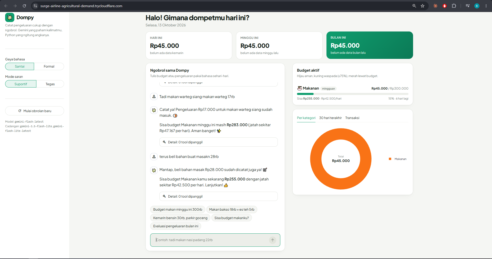
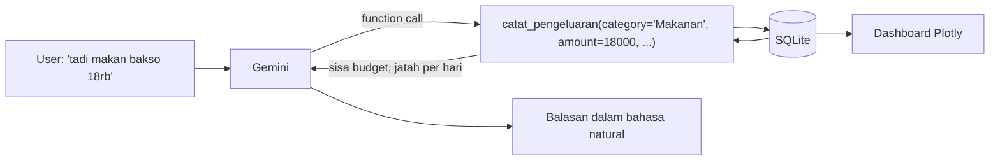
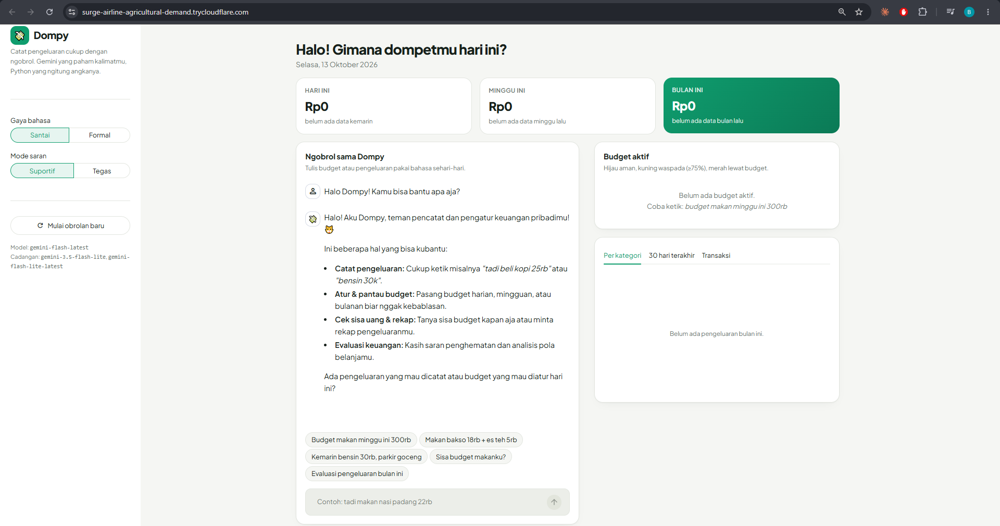

# Dompy: asisten budget pribadi berbasis Gemini

[](https://colab.research.google.com/github/Bambang-Saputra/Dompy/blob/main/Dompy.ipynb)

Dompy adalah chatbot untuk mengatur budget harian, mingguan, atau bulanan. Kamu tinggal ngobrol seperti biasa ("budget makan minggu ini 300rb", "tadi makan bakso 18rb"), dan Dompy akan mencatat, menghitung sisa budget, lalu memberi masukan soal pola pengeluaranmu.

Final project kelas **LLM-Based Tools and Gemini API Integration for Data Scientists** (Hacktiv8).



## Kenapa Dompy?

Aplikasi pencatat keuangan sering ditinggalkan karena mencatatnya ribet: buka aplikasi, pilih kategori, isi nominal, pilih tanggal. Di Dompy cukup satu kalimat. Gemini menerjemahkan kalimat sehari-hari jadi data terstruktur, sedangkan hitung-hitungannya tetap dikerjakan kode biasa supaya angkanya bisa dipercaya.

## Fitur

- Budget bisa per kategori atau total, dengan periode harian, mingguan (Senin sampai Minggu), bulanan, atau rentang tanggal bebas, misalnya dari gajian ke gajian.
- Pengeluaran dicatat pakai bahasa sehari-hari. Dompy paham "18rb", "1,5jt", "goceng", "ceban", "kemarin", atau "Sabtu lalu", dan satu pesan boleh berisi beberapa pengeluaran sekaligus.
- Setiap kali mencatat, Dompy menyebutkan sisa budget dan jatah per hari. Kalau pemakaian sudah 75% atau lewat budget, Dompy memberi peringatan.
- Untuk evaluasi, Dompy membandingkan pengeluaran dengan periode sebelumnya, mencari item yang paling sering dibeli, hari paling boros, dan beda pola weekday dengan weekend. Setelah itu Dompy mengusulkan budget untuk periode berikutnya.
- Budget, transaksi, dan riwayat obrolan disimpan di SQLite. Aplikasi boleh ditutup, Dompy tetap ingat semuanya saat dibuka lagi.
- Salah catat bisa dikoreksi lewat chat. Kalimat seperti "eh yang bakso tadi harusnya 15rb" membuat Dompy menghapus transaksi lama lalu mencatat ulang.
- Dashboard di samping chat menampilkan progress budget, komposisi pengeluaran per kategori, grafik harian, dan tabel transaksi. Isinya diperbarui setiap kali kamu mengirim pesan.
- Persona bisa diatur: gaya bahasa `santai` atau `formal`, dan mode saran `suportif` atau `tegas`.

## Cara kerja



Gemini tidak pernah menghitung sendiri. Tugasnya memahami maksud user lalu memanggil salah satu dari tujuh tool Python lewat **automatic function calling** dari SDK `google-genai`:

| Tool | Fungsi |
|---|---|
| `atur_budget` | Simpan/ganti budget per kategori dan periode |
| `catat_pengeluaran` | Catat pengeluaran, kembalikan status budget terkait |
| `cek_budget` | Kondisi semua budget aktif (terpakai, sisa, proyeksi) |
| `ringkasan_pengeluaran` | Rekap pada rentang tanggal tertentu |
| `daftar_transaksi` | Transaksi terakhir beserta ID |
| `hapus_transaksi` | Hapus transaksi yang salah catat |
| `analisis_pengeluaran` | Bahan evaluasi: perbandingan periode, kebiasaan, usulan budget |

LLM masih sering keliru menjumlah, jadi pembagian kerja ini disengaja. Angka yang dilihat user selalu berasal dari query database.

## Konfigurasi parameter

| Parameter | Nilai default | Alasan |
|---|---|---|
| `MODEL_NAME` | `gemini-flash-latest` | Alias ke model Flash stabil terbaru: cepat, murah, dan mendukung function calling. Bisa diganti ke versi spesifik seperti `gemini-3.6-flash`. |
| `MODEL_CADANGAN` | `gemini-3.5-flash-lite`, `gemini-flash-lite-latest` | Dicoba berurutan kalau model utama penuh (503) atau kena limit (429). Riwayat chat ikut dibawa. |
| `THINKING_LEVEL` | `low` | Mencatat pengeluaran tidak butuh mikir panjang. Level rendah membuat jawaban jauh lebih cepat. |
| `RETRY_PERCOBAAN` | `3` | Jumlah percobaan ulang otomatis per request saat server Gemini sibuk. |
| `TEMPERATURE` | `0.4` | Cukup rendah supaya interpretasi nominal dan kategori konsisten, tapi jawaban tetap luwes. |
| `GAYA_BAHASA` | `santai` | `santai` = akrab, pakai "kamu", maksimal 2 emoji. `formal` = baku, pakai "Anda", tanpa emoji. |
| `MODE_SARAN` | `suportif` | `suportif` = apresiasi dulu baru koreksi. `tegas` = langsung tunjuk pemborosan dan beri target. |
| `MAX_TOOL_CALLS` | `12` | Batas function call per pesan, cukup untuk satu pesan berisi banyak item. |
| `ZONA_WAKTU` | `Asia/Jakarta` | Penentu "hari ini" dan "kemarin" (runtime Colab memakai UTC). |
| `SIMPAN_DI_DRIVE` | `False` | Di Colab, set `True` supaya database disimpan di Google Drive dan tidak hilang saat runtime direset. |

Semua parameter ada di `config.py`, kecuali `SIMPAN_DI_DRIVE` yang ada di sel API key notebook. *System prompt* dibangun ulang setiap pesan, sehingga tanggal hari ini selalu benar dan perubahan persona dari sidebar langsung berlaku tanpa memulai obrolan baru.

## Menjalankan

[`Dompy.ipynb`](Dompy.ipynb) adalah pusat project ini. Sel-selnya menulis file aplikasi (`config.py`, `database.py`, `tools.py`, `agent.py`, `charts.py`, `app.py`) memakai `%%writefile`, mengetes tool-nya, lalu menjalankan Streamlit. File `.py` hasilnya juga ikut di-commit, jadi `streamlit run app.py` bisa langsung dipakai tanpa membuka notebook.

### Google Colab

1. Klik badge **Open in Colab** di atas. Bisa juga upload `Dompy.ipynb` lewat *File → Upload notebook*.
2. Buat API key gratis di [Google AI Studio](https://aistudio.google.com/apikey).
3. Di sidebar kiri Colab, buka 🔑 **Secrets**, tambahkan `GEMINI_API_KEY`, lalu aktifkan *Notebook access*.
4. Pilih *Runtime → Run all*. Sel terakhir menjalankan Streamlit dan mencetak link `trycloudflare.com` (lewat Cloudflare Tunnel). Link itu bisa dibuka di browser mana pun, termasuk HP, selama runtime masih hidup.

### Lokal

```bash
git clone https://github.com/Bambang-Saputra/Dompy.git
```

```bash
cd Dompy
```

```bash
pip install -r requirements.txt
```

Salin `.env.example` menjadi `.env` dan isi `GEMINI_API_KEY`. Setelah itu ada dua pilihan: buka `Dompy.ipynb` di Jupyter/VS Code lalu jalankan semua sel, atau langsung jalankan perintah di bawah. Aplikasi terbuka di `http://localhost:8501`.

```bash
streamlit run app.py
```

### Data contoh

Kalau ingin langsung mencoba fitur evaluasi, ubah `ISI_DATA_CONTOH = True` di bagian 8 notebook. Sel itu mengisi sekitar dua bulan pengeluaran acak yang realistis beserta beberapa budget.

## Contoh percakapan

```
Kamu  : Budget makan minggu ini 300rb ya
Dompy : Siap! Budget Makanan minggu ini (12-18 Okt) Rp300.000 sudah dicatat.

Kamu  : tadi siang makan bakso 18rb sama es teh 5rb
Dompy : Dicatat: bakso Rp18.000 dan es teh Rp5.000 (Makanan).
        Sisa budget makan Rp277.000 untuk 7 hari, sekitar Rp39.571/hari.

Kamu  : kasih evaluasi pengeluaranku bulan ini dong
Dompy : (ringkasan, perbandingan dengan bulan lalu, saran konkret, usulan budget bulan depan)
```

## Screenshot

| Mencatat pengeluaran + dashboard | Perkenalan Dompy |
|---|---|
|  |  |

## Struktur repo

```
Dompy/
├── Dompy.ipynb            # notebook utama: menulis semua file di bawah, tes tool, lalu menjalankan app
├── config.py              # parameter (model, temperature, gaya bahasa, mode saran, zona waktu)
├── database.py            # tabel SQLite + fungsi bantu periode, rupiah, status budget
├── tools.py               # 7 tool yang dipanggil Gemini lewat function calling
├── agent.py               # client Gemini, system prompt, sesi chat
├── charts.py              # grafik Plotly untuk dashboard
├── app.py                 # tampilan Streamlit
├── .streamlit/config.toml # tema Streamlit
├── requirements.txt
├── .env.example           # template API key untuk jalan lokal
└── screenshots/
```

## Batasan

- Dompy dibuat untuk satu pengguna. Semua data ada di file `data/dompy.db` lokal, atau di Google Drive kalau opsi itu dinyalakan.
- Dompy tidak merekomendasikan produk investasi tertentu. Urusannya pengeluaran dan budget.
- Pemahaman kalimat bergantung pada model Gemini yang dipakai. Kalau ada yang salah catat, minta Dompy mengoreksinya atau cek tab Transaksi.

## Teknologi

Python · [google-genai](https://pypi.org/project/google-genai/) (Gemini API, function calling) · [Streamlit](https://streamlit.io/) · SQLite · pandas · Plotly
